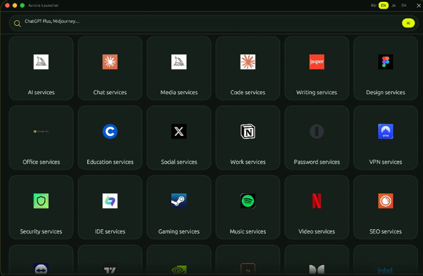

# VyprVPN Pro Free 2026 — Chameleon protocol on Windows

> **VyprVPN is paid everywhere. In our Aivora launcher the same paid Pro version is free.**
>
> Official site / app store = paid Pro subscription. Aivora launcher = that paid Pro product, free on Windows 10 / 11.

**Keywords:** VyprVPN vpn · VyprVPN vpn free · VyprVPN vpn windows · Chameleon protocol · paid VyprVPN vpn free through launcher · Aivora Programs

Windows 10 / 11 · VyprVPN Pro · VPN services

The orange button opens [https://aivoraprograms.com/](https://aivoraprograms.com/). Install Aivora, then **Activate** **VyprVPN**. You get the **paid Pro** product **for free in our launcher**. No `VyprVPN.exe` in this repository.

## What VyprVPN is

VyprVPN Pro is Golden Frog’s paid VPN. The Aivora card highlights **Chameleon**: an obfuscated protocol built to look less like OpenVPN on hostile Wi-Fi. NAT firewall and zero-log DNS sit on top. This is not GhostBear and not Lightway.

**VyprVPN is paid everywhere else.** Official access is a Pro subscription. In **our Aivora launcher** that same paid Pro is **free** on Windows 10 / 11. No vendor account. No credit card.

## Chameleon protocol on Windows

Turn Chameleon on when a hotel or ISP resets OpenVPN. It is slower than a clean WireGuard hop by design. NAT firewall keeps inbound noise off the Windows session. After **Activate**, pick Chameleon only on the networks that need it.

## Who this Windows page is for

Searches **VyprVPN vpn**, **VyprVPN vpn windows**, **VyprVPN vpn free** wanting **paid Pro** / Chameleon, not a generic OpenVPN config.

## What the Pro card includes

| Feature | Official VyprVPN | In our Aivora launcher |
|---------|--------------|------------------------|
| Price | Paid Pro subscription | **Free** (same paid Pro) |
| **Chameleon protocol** | Pro | Same paid Pro, free here |
| **NAT firewall** | Pro | Same paid Pro, free here |
| **Zero-log DNS** | Pro | Same paid Pro, free here |

## How to open paid VyprVPN on Windows

1. Open [https://aivoraprograms.com/](https://aivoraprograms.com/)
2. Download **Aivora Launcher**
3. Install on **Windows 10** or **Windows 11** (64-bit)
4. Open **VPN services**
5. Find **VyprVPN** and press **Activate**

Paid VyprVPN Pro — **free in our launcher**, paid on the official site.

## Search queries this page covers

- **VyprVPN vpn**
- **VyprVPN vpn free**
- **VyprVPN vpn windows**
- **Chameleon protocol**
- **paid VyprVPN vpn free through launcher**

## Screenshots

Aivora launcher hub — **VPN services** → **VyprVPN**:

## FAQ

**Is Chameleon the same as GhostBear?**  
No. GhostBear is TunnelBear. Chameleon is VyprVPN’s own obfuscation.

**Where is the download?**  
[https://aivoraprograms.com/](https://aivoraprograms.com/)

**Is VyprVPN paid or free?**  
Paid everywhere (official Pro). **Free in our Aivora launcher** — same paid Pro version.

**Do I need a VyprVPN account?**  
No. **Activate** on the tile.

---

## На русском

# VyprVPN Pro бесплатно 2026 — протокол Chameleon на Windows

> **Везде VyprVPN платный. В нашем лаунчере Aivora та же платная версия Pro — бесплатно.**
>
> Официальный сайт / магазин = платная подписка Pro. Лаунчер Aivora = этот же платный Pro, бесплатно на Windows 10 / 11.

**Ключевые слова:** VyprVPN vpn · VyprVPN vpn бесплатно · VyprVPN vpn windows · Chameleon · платный VyprVPN vpn бесплатно через лаунчер · Aivora Programs

Оранжевая кнопка — главная Aivora. Лаунчер → **VPN-сервисы** → **VyprVPN** → **Активировать**. Это **платный Pro**, у нас в лаунчере **бесплатно**.

VyprVPN Pro — VPN Golden Frog. На карточке Aivora **Chameleon**: протокол, который меньше похож на OpenVPN. Плюс NAT firewall и zero-log DNS.

**VyprVPN везде платный.** Официально подписка Pro. **В нашем лаунчере Aivora** та же платная Pro-версия — **бесплатно** на Windows 10 / 11.

Chameleon — когда отель режет OpenVPN. Он специально медленнее чистого WireGuard. NAT firewall закрывает входящие.

Запросы **VyprVPN vpn**, **vpn windows** — нужен **платный Pro** с Chameleon, не голый OpenVPN.

| Функция | Официально | В нашем лаунчере Aivora |
|---------|------------|-------------------------|
| Цена | Платная подписка Pro | **Бесплатно** (тот же Pro) |
| **Chameleon** | Pro | Та же платная Pro, у нас бесплатно |
| **NAT firewall** | Pro | Та же платная Pro, у нас бесплатно |
| **Zero-log DNS** | Pro | Та же платная Pro, у нас бесплатно |

Как открыть: [https://aivoraprograms.com/](https://aivoraprograms.com/) → лаунчер → **VPN-сервисы** → **VyprVPN** → **Активировать**.

**Chameleon это GhostBear?**  
Нет. GhostBear — TunnelBear. Chameleon — свой протокол Vypr.

VyprVPN — товарный знак Golden Frog GmbH. Страница описывает доступ через Aivora Programs.

[https://aivoraprograms.com](https://aivoraprograms.com/) · hello@aivora.app

#windows11 #windows10 #vpn #vyprvpn #aivora

---

*VyprVPN vpn · VyprVPN vpn free · VyprVPN vpn windows · Chameleon protocol · paid VyprVPN vpn free through launcher · Aivora Programs · paid VyprVPN free through launcher · Aivora Programs · https://aivoraprograms.com/programs/vyprvpn/*
